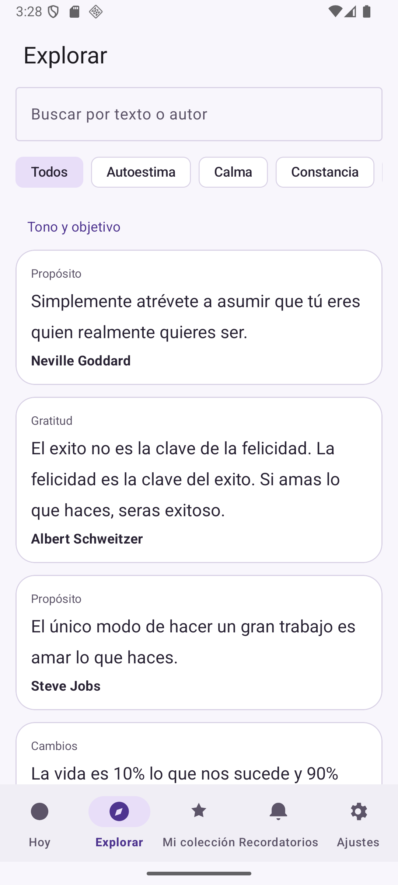
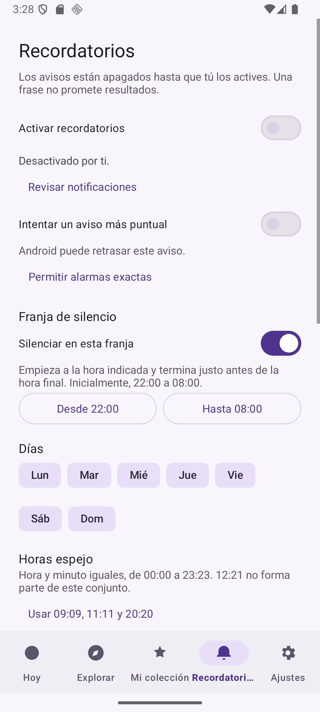
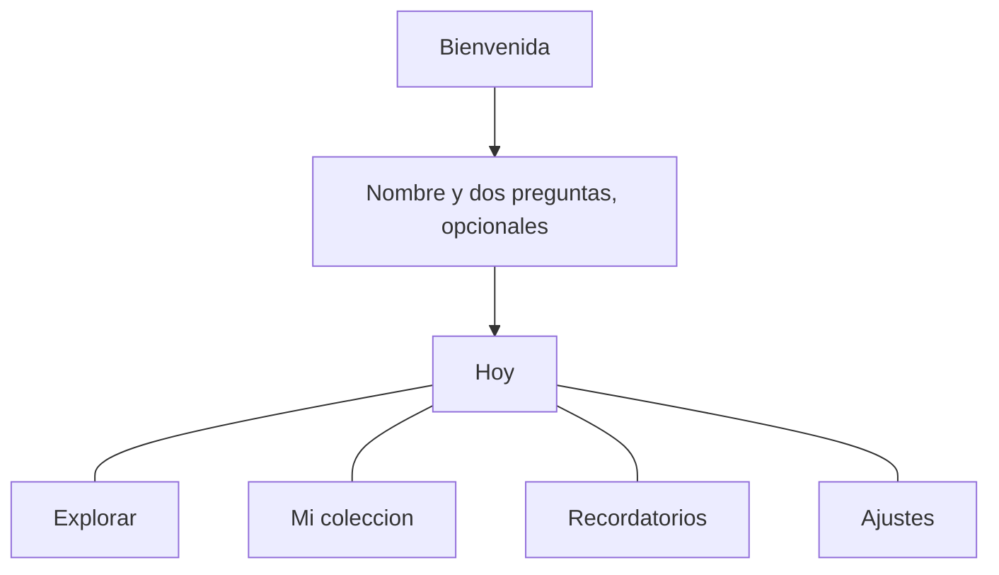
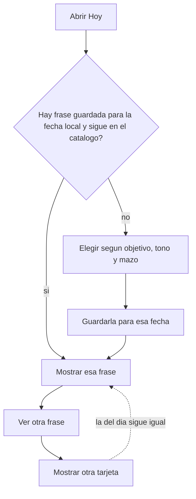
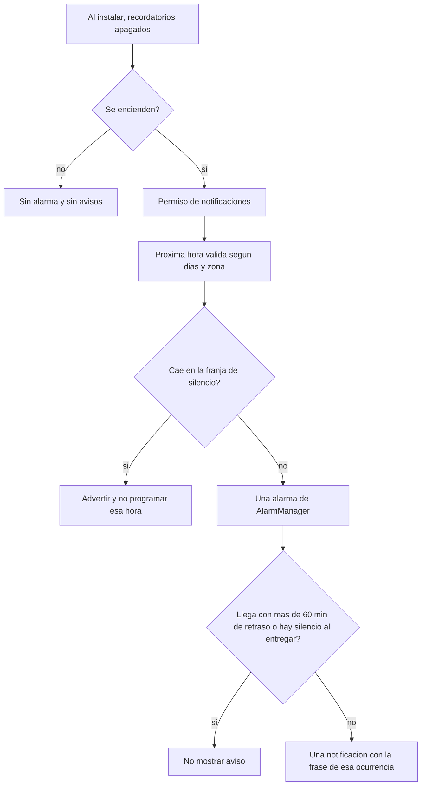
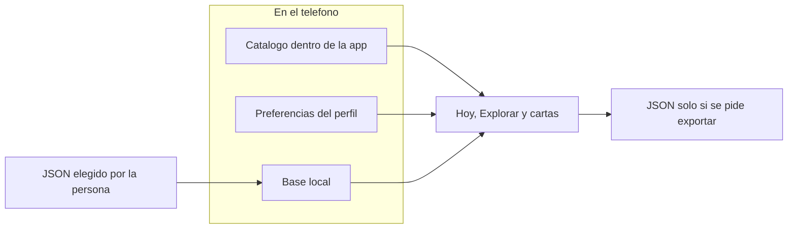

# Impulso

App Android de frases en español. Se usa sin cuenta, sin conexión y sin anuncios. El nombre en el lanzador es Impulso.

Sirve para volver, durante un día, a una sola frase. Esa frase no cambia sola a mitad de la jornada. Se puede guardar, escuchar, compartir y, si se quiere, recibir un aviso. Los recordatorios nacen apagados.

<p align="center">
  
  
</p>

## Por qué usarla

**La frase del día se queda.** Al abrir la app por la mañana aparece una frase y sigue siendo la misma si se vuelve a abrir por la tarde. «Ver otra frase» muestra otra tarjeta para mirar, pero no sustituye la del día. Así se puede retomar la misma idea sin que la pantalla haya cambiado sola.

**No pide cuenta ni red.** No hay registro, no hay servidor de la app y no hay anuncios. El catálogo viaja dentro del APK. Se puede abrir en un teléfono sin datos.

**No convierte el hábito en un puntaje.** Un día se marca como hecha, omitida o sin registrar. No hay rachas, ni porcentajes de bienestar, ni estadísticas que finjan un diagnóstico. Saltarse un día no borra lo anterior ni castiga con un número.

**El aviso es optativo y dice la verdad sobre Android.** Al instalar, los recordatorios están apagados. Encenderlos pide el permiso de notificaciones. El texto de la pantalla avisa de que Android puede retrasar el aviso. Una alarma más puntual solo se usa si la persona la pide y el sistema la permite. La app no declara el permiso que obligaría a una alarma exacta.

**La noche puede quedar en silencio.** Por defecto no se programan avisos entre las 22:00 y las 08:00. Si una hora elegida cae dentro de esa franja, la app lo advierte y no la programa. Durante esas horas, Hoy muestra la frase y oculta la pregunta, la acción breve y los botones de marcar el día.

**Lo que se escribe se queda en el teléfono.** El nombre (opcional, hasta 40 caracteres), las frases propias, los favoritos y el historial viven en el almacenamiento privado de la app. Compartir una imagen no imprime ese nombre. La app no usa micrófono ni ubicación: la nota de lugar, si se escribe, es un texto de hasta 80 caracteres.

**Cada frase del catálogo lleva autor.** No se presentan como si las hubiera escrito la app. Si en el origen el autor figuraba como desconocido, la tarjeta dice «Autor desconocido». Las frases escritas en el teléfono aparecen como «Tu frase».

**Se puede escuchar sin configurar nada extra.** La voz es la del sistema, en español, con velocidad y voz elegibles. No empieza sola. Al ir la app a segundo plano, la lectura se detiene.

## Instalar el APK

Cualquier persona con Android 8 o superior puede instalar el archivo que está en este repositorio:

[`dist/impulso-debug.apk`](dist/impulso-debug.apk)

Es un APK de depuración. No está firmado para Play Store y Android va a pedir confirmación porque no viene de la tienda.

1. Descargar `impulso-debug.apk`.
2. Abrirlo en el teléfono.
3. Si Android lo pide, permitir la instalación desde el navegador o el administrador de archivos que se esté usando.
4. Abrir Impulso.

Quien tenga el Android SDK y el teléfono conectado puede instalarlo así:

```bash
adb install -r dist/impulso-debug.apk
```

El identificador del paquete es `com.example.impulso` (provisional). La versión de este APK es 1.0.0.

## Qué se ve al abrirla

La primera vez hay una bienvenida de unos tres segundos, con el logo y el nombre de la app. **Continuar** está disponible desde el primer momento. Si TalkBack está activo o las animaciones del sistema están en cero, la bienvenida no avanza sola. Se puede omitir para las próximas aperturas desde Ajustes. Volver a la app desde segundo plano no la repite.

Después, una sola vez, se puede escribir un nombre y responder dos preguntas: qué se quiere fortalecer (autoestima, calma, constancia, enfoque, cambios o gratitud) y qué tono ayuda más (cercano, directo o espiritual). El nombre se puede dejar vacío. Si se cierra a medias, las respuestas ya elegidas siguen ahí. No se pregunta por notificaciones en ese paso.

A partir de ahí hay cinco destinos:

| Destino | Para qué sirve |
| --- | --- |
| Hoy | La frase del día, una pregunta breve, una acción pequeña y el estado del día |
| Explorar | Buscar en el catálogo por texto, autor, categoría y tono |
| Mi colección | Favoritos, frases propias y frases vistas hace poco |
| Recordatorios | Horas, días y franja de silencio. Apagado hasta que se encienda |
| Ajustes | Nombre, objetivo, tono, tema, copia de seguridad y el resto de opciones |



## La frase del día

La elección usa la fecha local del teléfono, el objetivo, el tono y el mazo activo. El tono espiritual solo entra si se eligió ese tono. Un objetivo vacío mira el catálogo completo, ya filtrado por tono.

La frase elegida se guarda para esa fecha. Si al día siguiente el catálogo ya no contiene esa frase, se elige otra y el día queda sin registrar: una frase que ya no existe no se queda marcada como hecha.

Cambiar el objetivo, el tono o el mazo no reemplaza la frase que ya se eligió hoy. El cambio vale para el día siguiente.



En la misma pantalla se puede:

- Marcar **Lo hice** o **Hoy lo dejo pasar**, y deshacerlo. La marca queda atada a la frase del día, no a la tarjeta que se esté mirando.
- Ver los últimos siete días como hecha, omitida o sin registrar.
- Dar vuelta la tarjeta al inglés que vino en la planilla de origen. No es una traducción hecha por la app.
- Dejar una frase como ancla de la semana («Tenerla esta semana»). Dura siete días y no reemplaza la del día.
- Ver, una sola vez, una frase marcada como hecha hace siete días.
- Pedir otra frase de otra categoría, con el mismo criterio de tono. Tampoco reemplaza la del día.
- Leer a pantalla completa, pasar las cartas del mazo o abrir un mapa de puntos por categoría. El mapa cuenta vistas y días marcados como hechos, con un tope de doce puntos por categoría. No es un porcentaje.
- Escribir una nota de lugar, a mano.
- Tras **Lo hice**, elegir cinco minutos de silencio con una alarma, o abrir los ajustes de política de notificaciones del sistema. La app no activa el modo no molestar por su cuenta.

Los mazos son: todo, descanso, oficio, interior y propias. Un mazo vacío que no sea el de frases propias vuelve al catálogo completo. El de propias usa solo lo escrito en el teléfono.

## Recordatorios

Nada se programa hasta que el interruptor se enciende. Apagarlo cancela la alarma y las notificaciones de la app.

Las horas espejo son aquellas en las que la hora y el minuto coinciden, de 00:00 a 23:23. Las sugerencias son 09:09, 11:11 y 20:20, y solo quedan activas si se aceptan. También se puede añadir una hora propia y elegir los días de la semana.

La franja de silencio empieza incluida y termina excluida. Si el inicio y el fin son la misma hora, no hay silencio. Una hora que cae dentro no se programa, y la pantalla lo dice.

Hay una sola alarma pendiente. Si dos horas coinciden, sale una sola notificación. El cálculo usa el calendario y la zona del teléfono, no una suma fija de 24 horas. En un cambio de hora, un hueco se salta y una hora repetida se entrega una sola vez.

Si el aviso llega con más de 60 minutos de retraso, o la entrega cae en la franja de silencio, no se muestra y no se recuperan los que se perdieron. La frase de esa ocurrencia queda guardada, para que el mismo aviso no cambie de texto.

Por defecto la alarma es aproximada. La exacta solo se pide si se elige y `canScheduleExactAlarms()` lo permite. Forzar el cierre de la app desde el sistema cancela las alarmas de Android: la app no promete que sigan sonando después de eso. Vuelven a conciliarse al abrirla, al reiniciar el teléfono, al cambiar la hora o la zona, o al actualizar el paquete.



Opcionalmente, y también apagado al empezar:

- Una notificación con la frase del día, visible en la pantalla de bloqueo, con **Lo hice** y **Hoy lo dejo pasar**. Android no deja poner un widget de otra app en la pantalla de bloqueo; esta notificación es el sustituto.
- Un aviso de cierre del día, a las 21:00 si no se cambia la hora. Si al sonar hay silencio, no se muestra.
- Un widget de inicio con la frase del día, que cambia a la medianoche local, y la próxima hora espejo.
- Atajos del sistema: la frase de hoy, escucharla, y hasta tres frases propias para que la búsqueda del teléfono las encuentre.

El aviso de hora espejo vibra un patrón corto. El canal no salta el modo no molestar.

## Compartir, voz y lectura

Desde una frase se puede copiar el texto, compartir el texto, o guardar una imagen cuadrada o vertical. La imagen lleva el logo y el nombre de Impulso, y el sello «Una frase no promete resultados.» No lleva el nombre de quien usa la app y no pide permiso de almacenamiento amplio: el archivo queda en la caché de la app.

Antes de guardar una frase propia se puede previsualizar esa estampa. Una frase propia tiene entre 1 y 500 caracteres, una categoría opcional, y borrar pide confirmación.

La lectura en voz alta dice la frase y el autor, hace una pausa y después dice la reflexión. «Escuchar la acción» dice solo la acción breve. Hay un sonido breve la primera vez que se abre la app en el día; se puede apagar, y no suena si el tono del teléfono no está en normal o si las animaciones están desactivadas.

También se puede generar un código QR de una frase (con el prefijo `impulso:`) y escanear uno para guardarla como frase propia. Si el texto no cabe en el código, la app lo dice. Se puede escribir una etiqueta NFC; el teléfono no necesita tener NFC para instalar la app. Android Beam no se usa.

El modo taller deja la pantalla encendida y va cambiando la frase cerca de las horas espejo. Hay un botón para salir. Los últimos 31 días se pueden imprimir con el diálogo de impresión del sistema.

## Temas

Claro, oscuro, el del sistema, o ilustración (terracota, oro y celeste). El oro es decorativo. La interfaz usa el borde de la pantalla y los controles principales miden al menos 48 dp. Con la letra al 200 %, Hoy se desplaza y la barra inferior no tapa la frase ni los botones.

## Dónde están los datos

No hay backend. El catálogo es un archivo dentro de la app. El perfil vive en preferencias. La frase de cada día, los favoritos, las frases propias y el historial viven en una base local. El historial de frases vistas se recorta a 200.



Exportar genera un JSON `impulso-backup`, versión 1. Importar un archivo inválido no cambia nada. Si el mismo dato está en el teléfono y en el archivo, se queda el del teléfono. Volver a importar el mismo archivo no duplica frases. Importar no enciende los recordatorios.

Si la copia de seguridad de Android está activa, el sistema puede incluir el nombre, las frases propias, los favoritos y el historial al respaldar el teléfono. Eso puede salir del aparato. La app no tiene otro canal para enviarlos.

Un registro de la app no escribe ese nombre ni el texto de las frases propias.

## Compilar

Hace falta un JDK 17 y el Android SDK 36. Android Studio escribe `local.properties` con la ruta del SDK. Ese archivo no se versiona y no debe compartirse: contiene una ruta de la máquina de quien compila.

```bash
./gradlew :app:assembleDebug :app:testDebugUnitTest :app:lintDebug
```

En Windows:

```powershell
.\gradlew.bat :app:assembleDebug :app:testDebugUnitTest :app:lintDebug
```

El APK de esa compilación queda en `app/build/outputs/apk/debug/app-debug.apk`. El que se puede descargar desde el repositorio es la copia en `dist/impulso-debug.apk`.

| | |
| --- | --- |
| Paquete | `com.example.impulso` (provisional) |
| Versión | 1.0.0 (versionCode 1) |
| minSdk | 26 |
| compileSdk / targetSdk | 36 |
| Lenguaje | Java 17 |
| Android Gradle Plugin | 8.13.2 |
| Gradle | 8.13 |

La actividad de inicio es `WelcomeActivity`. `MainActivity` no está exportada: otra app no puede abrirla directamente.

La base local está en la versión 2. La migración desde la versión 1 añade la nota de lugar. No hay migración que borre los datos.

## Catálogo

`app/src/main/assets/catalog.json` trae 68 frases distintas en español, con el autor indicado en la planilla de origen y, cuando existía, el texto en inglés de esa misma planilla. Las filas repetidas se guardaron una sola vez. La app no se atribuye esas frases.

Para regenerar el JSON hace falta un Excel con la hoja `Frases` y `openpyxl`. El libro no está en el repositorio.

```bash
python tools/import_frases.py ruta/al/libro.xlsx
```

## Pruebas

Hay pruebas de unidad del selector, de los horarios con una zona controlada, de la integridad del catálogo y de la importación. El recorrido en emulador, lo que no se llegó a probar en un aparato y los límites conocidos están en [`docs/QA.md`](docs/QA.md). Cómo se migran preferencias y respaldos está en [`docs/MIGRACION.md`](docs/MIGRACION.md).

## Licencia

Este repositorio no incluye un archivo `LICENSE`. Hasta que se elija una, no se concede una licencia de uso del código. Las frases del catálogo siguen perteneciendo a quien corresponda según el autor que aparece en cada una.
